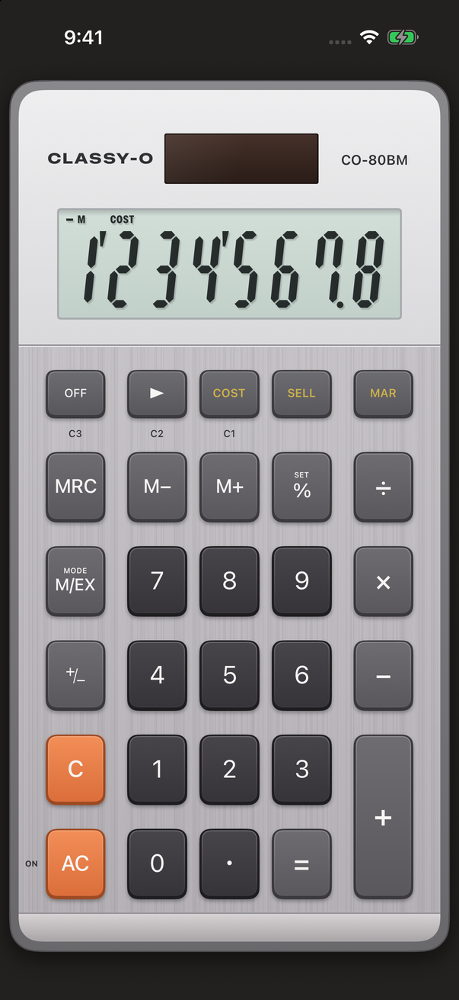
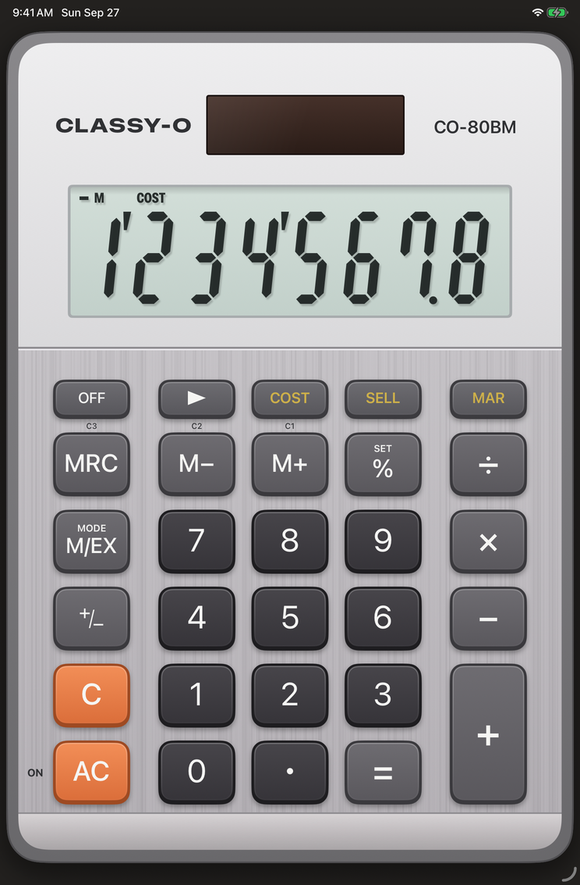

# Classy-O 80

An iPhone and iPad replica of the **Casio MS-80BM** desktop calculator. Same keys, same layout,
same 8-digit truncating logic, and the same quirky `%` key.

It ships as **Classy-O 80** and carries none of Casio's marks: the panel wordmark is `CLASSY-O`
and the model plate `CO-80BM`. This page and `docs/SPEC.md` name the hardware because that is what
the behaviour was copied from; nothing else in the project does. See
[docs/RELEASE.md](docs/RELEASE.md).

| iPhone | iPad mini |
|:---:|:---:|
|  |  |

## What it does

Every key on the real unit works the way its user's guide describes:

- 8-digit display with three-digit separators and results truncated, not rounded.
- Immediate-execution arithmetic (`6 ÷ 3 × 5 + 2.4 − 1 =` is 11.4, no precedence).
- Constants: press an operator twice for `K` (`23 + + 12 =` is 35, then `45 =` is 68).
- The percent key: `200 × 5 %` (10), `100 × 5 % +` (105), `500 × 20 % −` (400),
  `30 ÷ 60 %` (50), `12 − 10 %` (20, percent change), `120 + 25 % −` (160 then 40).
- Independent memory: `M+`, `M−`, `MRC` (twice clears).
- Corrections: `C` clears the entry, `▶` deletes the last digit, `AC` clears all but memory.
- `M/EX` switches to Conversion mode, where `M+`/`M−`/`MRC` become `C1`/`C2`/`C3`.
  Hold `%` for `SET` to store exchange rates.
- `COST` / `SELL` / `MAR`: enter any two, get the third; `MAR` twice shows the margin amount.
- `OFF`, `AC` to turn on, auto power off after about 6 minutes.

The full behavior spec, with every rule the manual does not settle marked as an assumption, is in
[docs/SPEC.md](docs/SPEC.md). The manual itself is Casio's, so it is not redistributed here; get it
from Casio's support site. Every example in it is a test in `ManualExamplesTests.swift`.

## Layout

| Path | What |
|---|---|
| `Packages/CalcEngine` | Pure Swift state machine for the calculator. No UI. |
| `Packages/CalcEngine/Tests` | Swift Testing suites. Every manual example is a test. |
| `ClassyO80/` | SwiftUI app: LCD, keypad, persistence, auto power off. |
| `ClassyO80Tests/`, `ClassyO80UITests/` | App unit tests and a UI smoke test. |
| `project.yml` | XcodeGen spec. The `.xcodeproj` is generated, not committed. |
| `Scripts/release.sh` | Test, archive, export and upload an App Store build. |
| `docs/appstore/` | Listing copy and the screenshot recipe. |
| `docs/RELEASE.md` | What to do for a submission, and what only a Mac can do. |

## Build and test

```sh
brew install xcodegen          # once
xcodegen generate
open ClassyO80.xcodeproj       # run the ClassyO80 scheme on a device or simulator

# Engine tests (fast, no simulator)
cd Packages/CalcEngine && swift test

# App tests
xcodebuild test -project ClassyO80.xcodeproj -scheme ClassyO80 \
  -destination 'platform=iOS Simulator,name=iPhone 17 Pro'
```

## Releasing

```sh
Scripts/release.sh            # test, archive, export build/export/ClassyO80.ipa
Scripts/release.sh --upload   # the same, then upload to App Store Connect
```

The full checklist, the listing copy and the screenshot sizes are in
[docs/RELEASE.md](docs/RELEASE.md).

## Extras beyond the real unit

- Long-press the display to copy the value.
- A hardware keyboard works on iPad: digits, `+ - * /`, Return or `=`, `%`, Delete for `▶`,
  Escape for `AC`, `c` for `C`.
- Memory, exchange rates and mode persist across launches.

## License

MIT. See [LICENSE](LICENSE).

---

Classy-O 80 is an independent replica built from the published user's guide. It is not affiliated
with, endorsed by, or sponsored by Casio Computer Co., Ltd. CASIO and MS-80BM are trademarks of
their owner and are used here only to say which calculator the behaviour was copied from.
